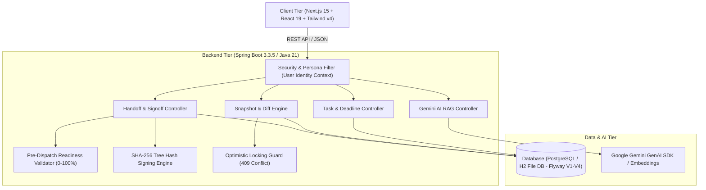
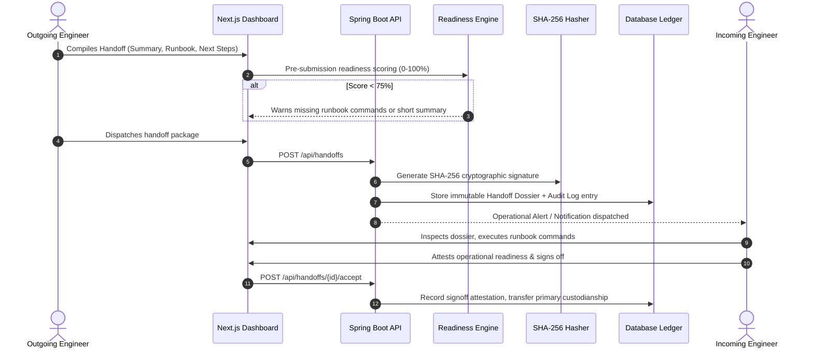

# 🚀 CONTINUITY — Digital Handoff & Continuity Management Platform

> **Simple explanation:** When people change shifts, switch projects, or take time off, important work and notes usually get lost in chats and emails. **CONTINUITY** makes sure that never happens. It packages up all the important context, checks if anything is missing, and transfers responsibility smoothly without losing any information.

---

## 📖 What is this Project?

In fast-moving teams, transferring a task or project from one person to another is risky:
- People forget to share key passwords or test commands.
- Next steps get lost in chat apps like Slack or Teams.
- Deadlines get missed because nobody knows who owns what.

**CONTINUITY** solves this problem by creating a **digital handoff package (dossier)**. Before you can hand off work, the system automatically checks if your handover is complete and ready. Once handed over, the receiving person has everything they need to start immediately.

---

## ✨ Main Features (In Simple Words)

### 1. 📦 Safe Handoff Packages (Dossiers)
- Package everything together: summary of what was done, test commands to run, next steps, and known risks.
- The person taking over gets a complete briefing in one place without asking 50 questions.

### 2. 🚦 Live Readiness Score (0% – 100%)
- The system checks your handoff before you send it:
  - Did you write an executive summary? (+30%)
  - Did you list completed milestones? (+25%)
  - Did you include runbook commands? (+25%)
  - Did you assign next steps? (+20%)
- If your score is under 75%, the system warns you so you don't hand over incomplete work.

### 3. ⏰ Task Deadlines & Overdue Alerts
- Every task can have an operational due date.
- If a task is past its deadline and not finished, it gets an eye-catching **OVERDUE** badge so urgent things are never forgotten.

### 4. 👥 Team Directory
- View all engineers and their current handoff load.
- Features our core leads:
  - **Jessicaa Chauhab** — Staff Platform Lead
  - **Yash Lokhande** — Principal Systems Architect
  - **Shruti Patil** — Lead Site Reliability Engineer

### 5. 📜 Immutable Audit Trail & Digital Receipts
- Every time a handoff is dispatched or signed off, an audit log entry is saved with a cryptographic hash.
- You can always prove who was responsible for what at any exact moment.

### 6. 🤖 AI Continuity Assistant
- An interactive AI helper that reads past handoffs, system architecture decisions (ADRs), and tasks to answer questions for new team members.

### 7. 🌗 Light Mode & Dark Mode
- One-click toggle between a clean crisp light theme and a sleek dark theme.
- Automatically saves your preference in your browser.

### 8. 📱 100% Mobile & Responsive Design
- Works smoothly on phones, tablets, and desktop computers.
- Collapsible navigation drawer and mobile-friendly popup menus.

---

## 🤝 Cross-Ecosystem Convergence: Trust Fabric (Blockchain) × CONTINUITY

> **Full Specification & Live Guide:** See [CONVERGENCE.md](file:///c:/Users/Yug%20Chapherkar/handoff2/handof/CONVERGENCE.md) for complete details.

### What is this partnership in simple words?
We connected **CONTINUITY** with **Team Trust Fabric** (an anti-counterfeit QR and Hyperledger Besu blockchain platform):
1. **What we GAVE them (Our Handoff Module):** When their blockchain catches a fake product, our system automatically creates **Case TC-1042**, breaks the incident into 3 urgent recall tasks with countdown deadlines, and locks our **Completeness Gate** so employees cannot blindly sign off on deliveries until the physical box is verified authentic.
2. **What we TOOK from them (Their Blockchain Endpoints):** We plugged our handoff dossiers into their **Ethereum Besu QBFT blockchain** (`0x02A2...`), giving our handoffs immutable cryptographic receipts, verifiable Merkle proofs, and zero-tamper database integrity.

* **Live Interactive Convergence Hub:** [https://converge.yugc.in/convergence](https://converge.yugc.in/convergence)
* **Live Partner API Base:** `https://continuity.404piyush.me`

---

## 🏛️ System Design & Architecture Blueprint

### 💡 The Core System Design Prompt
> **"Design a lossless, tamper-evident Digital Handoff & Continuity Management Platform that eliminates context fragmentation when engineering shifts rotate or task custodianship is transferred. The system must enforce structured pre-dispatch completeness scoring, maintain cryptographic ledger auditability (SHA-256), track task operational deadlines with overdue alerts, provide grounded contextual retrieval (RAG) over past architectural decisions, and guarantee zero information loss during high-stakes operational transfers."**

### 📐 High-Level Architecture



### 🔄 End-to-End Handover Data Flow



### 📋 Key System Design Pillars
1. **Lossless Context Bundling:** Combines code version hashes, runbook diagnostic probes, ADR decisions, and immediate blockers into a unified transfer package.
2. **Automated Quality Gate (Readiness Validator):** Algorithmic scoring (+30% Summary, +25% Milestones, +25% Runbooks, +20% Next Steps) preventing incomplete handovers.
3. **Concurrency Conflict Prevention:** Optimistic locking guards against concurrent state overwrite (`409 Conflict`).
4. **Cryptographic Proof of Handover:** Verifiable SHA-256 tree hashing generates digital receipts proving who handed what to whom at any point in time.

---

## 🛠️ Tech Stack Made Easy

| Part | Technology | What it does |
| :--- | :--- | :--- |
| **Frontend** | Next.js 15, React 19, Tailwind CSS | The modern website interface you see and click on. |
| **Backend** | Java 21, Spring Boot 3.3.5 | The fast, secure server handling data and business rules. |
| **Database** | PostgreSQL / H2 Database + Flyway | Stores users, workspaces, tasks, and handoff packages safely. |
| **Icons & Style** | Lucide React | Clean, intuitive icons. |

---

## 🚀 How to Run the Project (Step-by-Step)

You need to run two things: the **Backend server** and the **Frontend website**.

### Prerequisites
Make sure you have installed:
1. **Node.js** (version 18 or newer)
2. **Java JDK 21**
3. **Maven** (or use the included wrapper)

---

### Step 1: Start the Backend (Port 8080)

1. Open your terminal and go into the `backend` folder:
   ```bash
   cd backend
   ```

2. Run the Spring Boot server:
   ```bash
   mvn spring-boot:run
   ```

3. Your backend is now running at:
   - **API URL:** `http://localhost:8080/api`
   - **Swagger API Documentation:** `http://localhost:8080/swagger-ui.html`
   - **Health Check:** `http://localhost:8080/api/health`

---

### Step 2: Start the Frontend (Port 3000)

1. Open a **second terminal** and stay in the root project folder:
   ```bash
   # (If running for the first time, install packages:)
   npm install
   ```

2. Start the development server:
   ```bash
   npm run dev
   ```

3. Open your browser and visit:
   ```
   http://localhost:3000
   ```

---

## 📁 Project Folder Structure

```
handoff/
├── app/                  # Next.js pages and routes
│   ├── (dashboard)/      # Main app pages (Home, Team, Handoffs, Projects, Audit)
│   ├── globals.css       # Global styling tokens & light/dark mode rules
│   └── layout.tsx        # Base HTML layout
├── components/           # Reusable UI widgets
│   └── ui/               # Modals, TopBar, Sidebar, Avatar, Popovers
├── context/              # App state management (AppContext.tsx)
├── lib/                  # Helper utilities and initial data
├── backend/              # Spring Boot Java application
│   ├── src/main/java/    # Java controllers, services, entities, and security
│   ├── src/main/resources/db/migration/ # Database schema migrations (V1 to V4)
│   └── pom.xml           # Backend dependencies and build settings
└── package.json          # Frontend packages and scripts
```

---

## 🧪 Running Tests

### Backend Tests
Check that all 19 automated tests pass:
```bash
cd backend
mvn test
```

### Frontend Build Check
Verify that the website compiles without any errors:
```bash
npm run build
```

---

---

## 🗺️ Interactive Platform Tour & Page Directory

| Route | View Name | Key Operational Purpose |
| :--- | :--- | :--- |
| `/` | **Operations Command Center** | Hero metrics, pending action items assigned to you, and fast "+ Start a handoff" CTA. |
| `/projects` | **Workspace Manager** | Inspect distributed projects (e.g. Apollo Raft Core), code snapshot versions, and ADR decisions. |
| `/handoffs` | **Handoff Dossiers Directory** | Filter handoffs by Pending, Accepted, or Critical status. |
| `/handoffs/[id]` | **Dossier Deep Inspection** | Full verification view: check completed milestones, copy runbook diagnostic commands, and execute digital signoff. |
| `/team` | **Team Directory** | View lead custodians (**Jessicaa Chauhab**, **Yash Lokhande**, **Shruti Patil**), active projects, and shift locations. |
| `/audit` | **Immutable Audit Trail** | Cryptographic ledger verifying every dispatch, signoff, and task transition with SHA-256 tree hashes. |
| `/assistant` | **AI Continuity Copilot** | Interactive RAG terminal answering complex architectural and onboarding questions using Google Gemini. |

---

## ❓ Troubleshooting & FAQs

### Q: What if Port 8080 or 3000 is already in use?
- **Backend (Port 8080):** Set a different port by running `mvn spring-boot:run -Dspring-boot.run.arguments="--server.port=8081"`.
- **Frontend (Port 3000):** Run `npm run dev -- -p 3001` to start Next.js on port 3001.

### Q: Does the frontend work if the backend is restarting?
- **Yes.** The Next.js frontend has built-in mock fallbacks and optimistic UI updates so the interface remains fully interactive and responsive even during backend maintenance.

### Q: How do I reset the local database?
- Simply delete the `./backend/storage/db/` directory and restart the backend. Flyway will automatically run migrations `V1` through `V4` to seed a fresh database.

---

## 🤝 Need Help?
- Click the **AI Terminal** tab on the left menu inside the app to ask questions about any handoff or project.
- Click the **Sun / Moon** icon in the top right corner to switch between light and dark modes.

