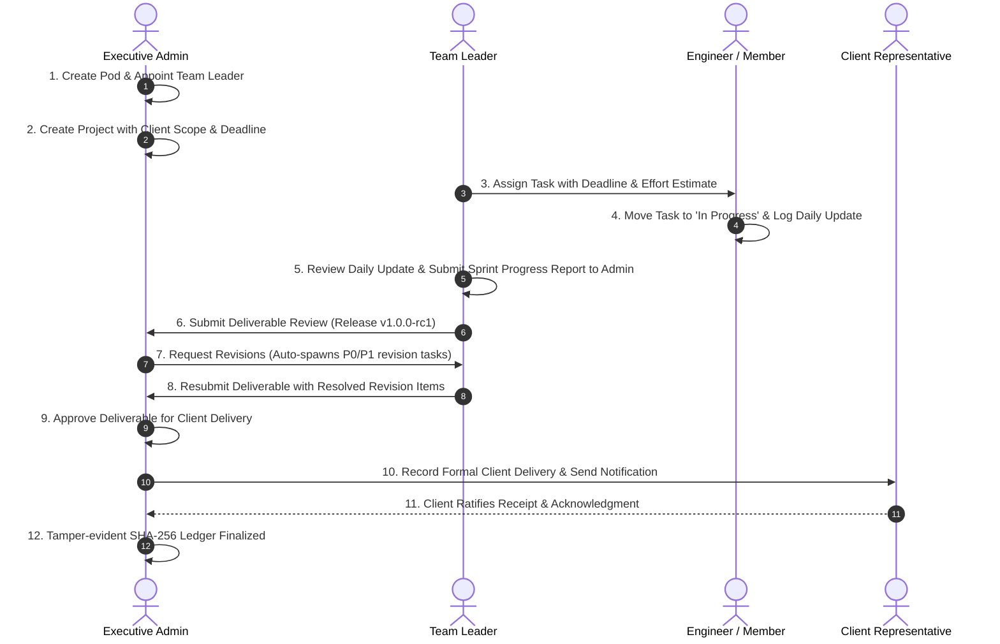
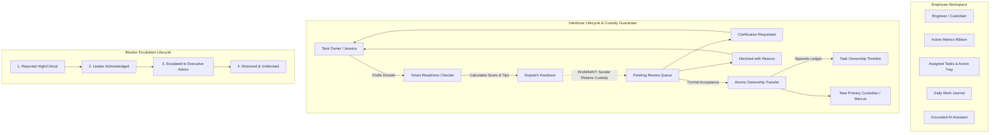

# 🚀 CONTINUITY — Enterprise Project Continuity, Team Governance & Client Delivery Platform

> **CONTINUITY** is an enterprise-grade AI-powered platform for project continuity, team pod management, employee accountability, multi-round deliverable review, and verified client delivery. Built with strict role-based access control (RBAC), tamper-evident cryptographic audit logs (SHA-256), and grounded contextual intelligence.

---

## 🏛️ Executive Product Architecture

In fast-paced engineering organizations, transfers across shifts, teams, and client milestones often suffer from context fragmentation, unrecorded blockers, missed handoffs, and vague delivery sign-offs.

**CONTINUITY** eliminates this gap by providing an end-to-end governance lifecycle where:
1. **Admins** configure execution pods, appoint and transfer team leaders, establish projects with defined client scopes, monitor real-time organizational KPIs, review milestone deliverables, request structured revisions, and record final client delivery.
2. **Team Leaders** direct execution inside their assigned pods, distribute tasks to engineers, track blockers and deadlines, review daily updates, and report periodic progress to Admins.
3. **Employees** log daily work notes, track assigned tasks through all lifecycle stages, submit evidence, and raise operational blockers without information loss.

---

## 👥 Three-Tier Role-Based Access Control (RBAC)

The platform strictly differentiates access and permissions across three core roles:

| Capability / Action | Admin | Team Leader | Employee |
| :--- | :---: | :---: | :---: |
| **Executive Governance Dashboard** | Full Org-Wide View | Assigned Pod Scope | Personal Task Scope |
| **Create Teams & Appoint Pod Leaders** | ✅ Yes | ❌ No | ❌ No |
| **Transfer Members Between Teams** | ✅ Yes | ❌ No | ❌ No |
| **Create & Assign Projects** | ✅ Yes | ❌ No | ❌ No |
| **Assign & Distribute Tasks** | ✅ Yes | ✅ Yes (Assigned Pods) | ❌ No |
| **Update Task Lifecycle & Log Blockers** | ✅ Yes | ✅ Yes | ✅ Yes (Assigned Tasks) |
| **Submit Employee Daily Work Updates** | ✅ Yes | ✅ Yes | ✅ Yes |
| **Review & Confirm Daily Updates** | ✅ Yes | ✅ Yes (Assigned Pods) | ❌ No |
| **Submit Sprint / Progress Reports to Admin** | ✅ Yes | ✅ Yes | ❌ No |
| **Submit Milestone Deliverables for Review** | ✅ Yes | ✅ Yes | ❌ No |
| **Multi-Round Deliverable Review (Approve / Changes Requested)** | ✅ Yes | ❌ No (Read-Only) | ❌ No |
| **Record Client Release Delivery** | ✅ Yes | ❌ No | ❌ No |
| **Ratify Client Receipt Acknowledgment** | ✅ Yes | ❌ No | ❌ No |
| **View Immutable SHA-256 Audit Ledger** | ✅ Yes | ✅ Yes (Read-Only) | ✅ Yes (Read-Only) |

---

## 📊 Executive Governance Dashboard (10 Real KPI Pulses)

The executive dashboard renders 10 calculated operational metrics without dummy placeholders:

1. **Total Employees** — Active vs. inactive personnel count.
2. **Active Teams** — Operational engineering pods with assigned leaders.
3. **Active Projects** — In-flight development workstreams.
4. **At-Risk Projects** — Workstreams impacted by blockers, revisions, or pending deadlines.
5. **Overdue Tasks** — Incomplete tasks with past operational deadlines.
6. **Pending Reports** — Unreviewed progress submissions from Team Leaders.
7. **Pending Reviews** — Milestone deliverables awaiting executive sign-off.
8. **Revision Requests** — Deliverables rejected with structured revision tasks.
9. **Approved Releases** — Releases certified by Admin ready for client handover.
10. **Delivered Releases** — Formally delivered releases with client acknowledgment records.

---

## 🔄 End-to-End Enterprise Lifecycle



---

## 🛠️ Technology Stack

| Layer | Technologies | Description |
| :--- | :--- | :--- |
| **Frontend** | Next.js 15 (App Router), React 19, Tailwind CSS | High-performance responsive web client with light/dark theme persistence |
| **API & Server Store** | Next.js Route Handlers + TypeScript | Atomic file-persisted JSON database (`storage/continuity_store.json`) with optimistic locking |
| **Enterprise Backend** | Java 21, Spring Boot 3.3.5 | Enterprise REST controllers, Spring Data JPA, Flyway DB migrations |
| **Database Schemas** | PostgreSQL / H2 Database | Full Flyway migrations `V1` through `V5` supporting relational persistence |
| **Security & Auditing** | Node.js Crypto / Java SHA-256 | Immutable hash-chained audit logging across all state transitions |
| **AI Continuity Assistant**| Gemini API / Local Grounded Context | File-grounded architectural assistant with zero-hallucination fallback |

---

## 📁 Repository Structure

```
Continuity/
├── app/                              # Next.js 15 App Router
│   ├── (dashboard)/                  # Dashboard & Core Views
│   │   ├── page.tsx                  # Executive Governance Command Center
│   │   ├── admin/teams/page.tsx      # Pod Management & Leader Appointments
│   │   ├── admin/employees/page.tsx  # Employee Directory & Role Allocations
│   │   ├── admin/reviews/page.tsx    # Multi-Round Deliverable Review Matrix
│   │   ├── admin/deliveries/page.tsx # Client Delivery Ledger & Signoff
│   │   ├── reports/page.tsx          # Team Leader Progress Reports
│   │   ├── updates/page.tsx          # Daily Work Update Submissions
│   │   ├── tasks/page.tsx            # Universal Task Board
│   │   ├── notifications/page.tsx    # In-App Alert Center
│   │   ├── projects/page.tsx         # Workspace Manager & Versions
│   │   ├── handoffs/page.tsx         # Digital Handoff Dossiers
│   │   ├── audit/page.tsx            # Cryptographic SHA-256 Ledger
│   │   └── assistant/page.tsx        # AI Continuity Copilot
│   ├── api/                          # Next.js REST API Handlers
│   │   ├── auth/me/route.ts          # Identity resolution via X-User-Id
│   │   ├── users/route.ts            # User onboarding & role updates
│   │   ├── teams/                    # Pod management & member routing
│   │   ├── projects/                 # Project creation & health rules
│   │   ├── tasks/                    # Task lifecycle & assignments
│   │   ├── updates/                  # Daily work notes & leader review
│   │   ├── reports/                  # Sprint progress reports
│   │   ├── reviews/                  # Multi-round deliverable review
│   │   ├── deliveries/               # Client release delivery & receipt
│   │   ├── audit/route.ts            # SHA-256 audit ledger retrieval
│   │   └── notifications/route.ts    # In-app notifications
├── components/ui/                    # Reusable Design System Widgets
│   ├── Sidebar.tsx                   # Role-filtered navigation & persona switcher
│   ├── TopBar.tsx                    # Search, quick actions & user status
│   └── GlobalCommandPalette.tsx      # Keyboard-driven navigation (Ctrl+K)
├── context/
│   └── AppContext.tsx                # Unified client context & live state
├── lib/
│   ├── types.ts                      # Strict TypeScript data models
│   ├── api.ts                        # Fully typed client API fetchers
│   └── server-store.ts               # Atomic store persistence & RBAC helpers
├── backend/                          # Spring Boot 3.3.5 Application
│   ├── src/main/java/                # Controllers, services, and security
│   └── src/main/resources/db/migration/ # Flyway migrations (V1 to V5)
│       └── V5__enterprise_platform_schema.sql # Enterprise schema migration
└── scripts/
    ├── test_e2e_flow.ps1             # 15-step automated end-to-end test suite
    └── test_routes.ps1               # Automated HTTP route health checks
```

---

## 🚀 Quickstart Guide

### Prerequisites
- **Node.js** >= 18.18.0
- **Java JDK 21** (if running the Spring Boot backend)
- **Maven 3.9+** (or use the included wrapper)

### Step 1: Start the Frontend Application
```bash
# Install NPM dependencies
npm install

# Start Next.js development server
npm run dev
```
Open **`http://localhost:3000`** in your browser.

> **Tip:** Use the persona switcher in the bottom-left of the sidebar to immediately switch between:
> - **Alexander Ward** (`Admin`)
> - **Marcus Vance** (`Team Leader`)
> - **Jessica Chauhan** (`Employee`)

---

### Step 2: (Optional) Run the Spring Boot Backend
```bash
cd backend
mvn spring-boot:run
```
- **Backend API:** `http://localhost:8080/api`
- **Swagger Documentation:** `http://localhost:8080/swagger-ui.html`

---

## 🧪 Automated Verification & Testing

### 1. 15-Step End-to-End Workflow Verification
Verifies the complete cycle (Admin creates team -> Admin creates project -> Leader assigns task -> Employee logs update -> Leader reviews -> Leader reports -> Leader submits deliverable -> Admin requests revision -> Revision resubmitted -> Admin approves -> Admin records delivery -> Client acknowledges):
```powershell
powershell -ExecutionPolicy Bypass -File scripts\test_e2e_flow.ps1
```

### 2. Route Health Check
Verifies all dashboard and API endpoints return HTTP 200:
```powershell
powershell -ExecutionPolicy Bypass -File scripts\test_routes.ps1
```

### 3. Employee Workbench & Handover Verification (10-Step Suite)
Verifies employee identity, readiness checker (100%), lossless handover creation, clarification requests, atomic recipient acceptance, task ownership timeline, task comments, blocker lifecycle (Reported -> Acknowledged -> Escalated -> Resolved), daily work journal, and grounded AI assistant citations & non-fabrication refusal:
```powershell
powershell -ExecutionPolicy Bypass -File scripts\test_employee_workbench.ps1
```

### 4. TypeScript Compilation
Verifies clean compilation with zero type errors:
```bash
npx tsc --noEmit
```

### 5. Backend Unit & Integration Tests
```bash
cd backend
mvn test
```

---

## 💼 Employee Workbench & Handover Architecture

The **Employee Dashboard** (`components/employee/EmployeeDashboard.tsx`) provides engineers with an integrated operational command center:



### 1. Smart Handover Readiness Checker
- Evaluates 6 key operational dimensions in real time (0–100% score):
  - **Executive Summary Completeness** (≥ 25 chars)
  - **Completed Work Items** (≥ 1 item)
  - **Pending / Next Steps** (≥ 1 item)
  - **Reproducible Runbook Commands** (≥ 1 command)
  - **Setup Instructions & Environment Config** (≥ 15 chars)
  - **Attached Code Files / Artifacts** (≥ 1 file)
- Displays a visual health bar with contextual improvement suggestions before sending.

### 2. Task Ownership Timeline
- Maintains an immutable, timestamped custody log for every task:
  - Previous owner & new owner
  - Associated handoff dossier ID
  - Transfer method (`Creation`, `Recipient Acceptance`, or `Manager Override`)
  - Sign-off notes and SHA-256 integrity hash

### 3. Daily Work Journal
- Enables employees to record structured daily progress:
  - Completed work items
  - In-progress initiatives & milestones
  - Planned next steps
  - Operational blockers (automatically cross-links with the blocker workflow)
- Seamlessly feeds into the Team Leader review queue.

### 4. Blocker Escalation Lifecycle
- Four-stage blocker governance:
  1. **Reported**: Employee flags a task as blocked with severity (`Low`, `Medium`, `High`, `Critical`).
  2. **Acknowledged**: Team Leader acknowledges awareness within the pod.
  3. **Escalated**: Unresolved or cross-team platform dependencies escalated to Admin.
  4. **Resolved**: Blocker resolved with notes; task atomically returns to `In Progress`.

### 5. Lossless Handover Guarantee (Core Invariant)
- **Zero Premature Transfers**: Handover creation does **not** transfer task ownership. The sender remains the primary owner until the recipient formally accepts or a manager initiates an override.
- **Clarification & Decline Handling**: If the recipient asks questions or declines, the task remains safely in the sender's custody with zero orphan states.

### 6. Grounded AI Project Assistant
- Answers complex architectural, workflow, and runbook questions using authorized project files, ADRs, tasks, and handoff dossiers.
- **Security & Privacy**: Automatically sanitizes tokens, private keys, and passwords before query dispatch.
- **Zero Fabrication**: Explicitly refuses ungrounded speculation if documentation is absent, always citing verified sources.

---

## 🔒 Security & Data Integrity

1. **Role Enforcement**: API endpoints reject unauthorized mutations with HTTP `403 Forbidden` if an actor lacks the necessary permissions.
2. **Tamper-Evident Hashing**: Every milestone review, team appointment, task transition, and client delivery record is sealed into an immutable SHA-256 chained audit record.
3. **Database Migrations**: Flyway migrations `V1` through `V6` (`V6__employee_workbench_schema.sql`) support enterprise PostgreSQL relational persistence.
4. **Optimistic Locking**: Concurrent updates are safeguarded against state overwrite conflicts.
5. **Offline Fallback**: The frontend functions seamlessly with in-memory persistence and offline intelligence even during backend maintenance windows.

---

## 📜 License
Internal Enterprise Use — CONTINUITY Platform Team.

