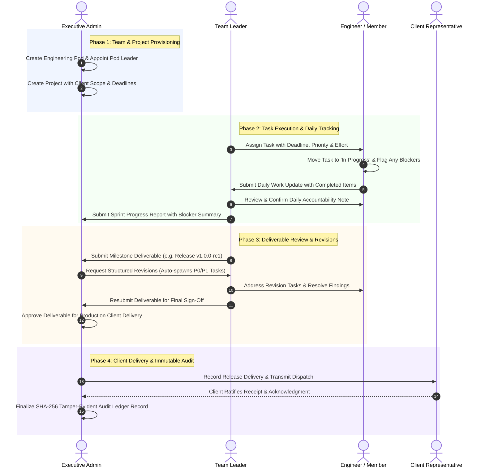
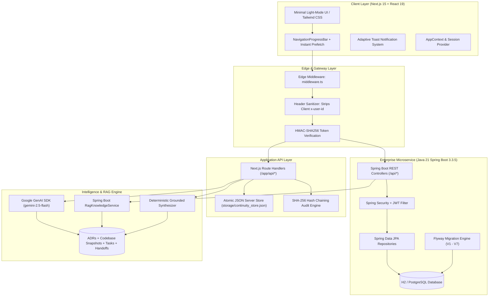
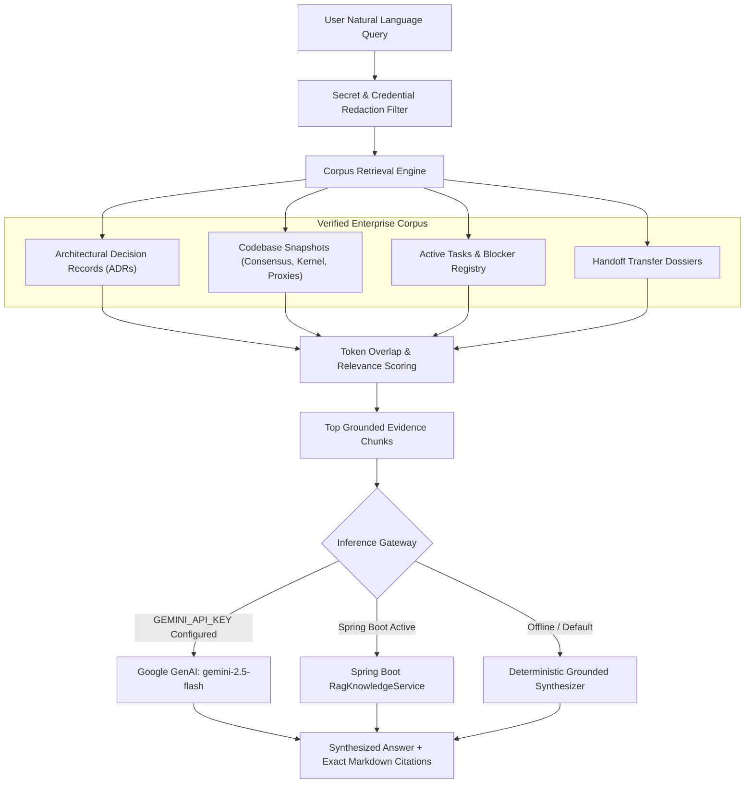

# 🚀 CONTINUITY — Enterprise Project Continuity, Team Governance & Client Delivery Platform

> **CONTINUITY** is an enterprise-grade platform engineered to eliminate operational context loss, streamline shift handoffs, enforce team accountability, govern multi-round client deliverable reviews, and cryptographically verify milestone delivery. 
> 
> Built on a high-performance **Next.js 15 (React 19)** web architecture and backed by an enterprise **Java 21 Spring Boot 3.3.5** microservice, CONTINUITY features strict Three-Tier Role-Based Access Control (RBAC), tamper-evident SHA-256 audit ledgers, a dual-engine RAG knowledge terminal (Google Gemini GenAI + Spring Boot RAG), and secure BCrypt + JWT HTTP-only cookie authentication.

---

## 📑 Table of Contents

1. [Executive Summary & Problem Statement](#-executive-summary--problem-statement)
2. [Key Highlights & Core Capabilities](#-key-highlights--core-capabilities)
3. [Three-Tier Role-Based Access Control (RBAC)](#-three-tier-role-based-access-control-rbac)
4. [End-to-End Enterprise Governance Lifecycle](#-end-to-end-enterprise-governance-lifecycle)
5. [System Architecture & Data Flow](#-system-architecture--data-flow)
6. [Retrieval-Augmented Generation (RAG) Architecture](#-retrieval-augmented-generation-rag-architecture)
7. [Core Platform Modules & Dashboards](#-core-platform-modules--dashboards)
8. [Enterprise Security & Cryptographic Verifiability](#-enterprise-security--cryptographic-verifiability)
9. [Technology Stack](#-technology-stack)
10. [Repository Structure](#-repository-structure)
11. [Complete REST API Reference](#-complete-rest-api-reference)
12. [Database Schema & Migrations](#-database-schema--migrations)
13. [Getting Started & Installation Guide](#-getting-started--installation-guide)
14. [Demo Accounts & 1-Click Credentials](#-demo-accounts--1-click-credentials)
15. [Automated Verification & Testing](#-automated-verification--testing)
16. [Production Deployment & Environment Configuration](#-production-deployment--environment-configuration)
17. [License](#-license)

---

## 🏛️ Executive Summary & Problem Statement

In modern multi-pod engineering organizations, cross-shift transitions, team handoffs, and client delivery reviews frequently suffer from:
* **Context Fragmentation**: Shift changes and team reassignments lose critical runtime context, unmerged commits, and configuration flags.
* **Unrecorded Blockers & Silent Failures**: Task impediments remain trapped in chat channels or local scratchpads without structured escalation.
* **Opaque Review Loops**: Milestone deliverables bounce between engineering pods and executive reviewers without versioned revision tasks or sign-off criteria.
* **Unverified Client Sign-Offs**: Deliverable shipments lack tamper-evident receipts, audit trails, and formal client acknowledgment.

**CONTINUITY** solves these failures by establishing an end-to-end governance lifecycle where every task state, daily update, team report, review iteration, shift handoff, and client release is bound to an immutable, cryptographically verifiable ledger.

---

## ✨ Key Highlights & Core Capabilities

* **Minimal Light-Mode Aesthetic**: Clean, high-contrast, distraction-free UI design with pure `#000000` headings, `#F8FAFC` slate canvas, refined typography, and full dark-mode compatibility.
* **Instantaneous Navigation**: Instant prewarming on hover/viewport and a zero-delay global route progress bar (`NavigationProgressBar`), ensuring smooth route switches without layout shifts.
* **Executive Governance Pulse**: 10 real-time organizational KPIs calculated live across team pods, task statuses, blocker queues, reports, and release deliveries.
* **4-Dimension Handoff Completeness Scoring**: Automated scoring of shift handoffs across Documentation (25%), Task Linkages (25%), Blocker Flagging (25%), and Runbook Verification (25%) with SHA-256 integrity sealing and JSON receipt export.
* **Multi-Round Deliverable Reviews**: Admin review matrix with automated P0/P1 corrective task generation upon revision requests.
* **Client Delivery Ledger**: Formal client delivery sign-offs and client acknowledgment ratification.
* **AI Knowledge Assistant (RAG)**: Zero-hallucination semantic search over Architectural Decision Records (ADRs), codebase snapshots, active tasks, and handoff dossiers, featuring automated secret redaction and mandatory citations.
* **Strict Enterprise Security**: BCrypt password hashing, 256-bit HMAC-SHA256 JWTs in HTTP-only cookies, edge middleware authentication, anti-spoofing header filters, and automated security test suites.

---

## 👥 Three-Tier Role-Based Access Control (RBAC)

The platform enforces strict role differentiation across **Admin**, **Team Leader**, and **Employee**:

| Capability / Action | Admin | Team Leader | Employee |
| :--- | :---: | :---: | :---: |
| **Executive Governance Dashboard (`/dashboard`)** | Full Org-Wide View | Assigned Pod Scope | Personal Workbench Scope |
| **Create Engineering Pods & Appoint Leaders** | ✅ Full Access | ❌ Forbidden | ❌ Forbidden |
| **Transfer Members Between Pods** | ✅ Full Access | ❌ Forbidden | ❌ Forbidden |
| **Create & Govern Projects / Repositories** | ✅ Full Access | ❌ Forbidden | ❌ Forbidden |
| **Assign & Distribute Tasks** | ✅ Full Access | ✅ Assigned Pods | ❌ Forbidden |
| **Update Task Lifecycle & Log Blockers** | ✅ Full Access | ✅ Assigned Pods | ✅ Assigned Tasks |
| **Log Daily Work Notes & Updates** | ✅ Full Access | ✅ Full Access | ✅ Full Access |
| **Review & Confirm Daily Work Updates** | ✅ Full Access | ✅ Assigned Pods | ❌ Forbidden |
| **Submit Sprint / Progress Reports to Admin** | ✅ Full Access | ✅ Full Access | ❌ Forbidden |
| **Submit Milestone Deliverables for Review** | ✅ Full Access | ✅ Full Access | ❌ Forbidden |
| **Multi-Round Deliverable Review (Approve / Reject)**| ✅ Full Access | ❌ Read-Only | ❌ Read-Only |
| **Record Client Release Delivery** | ✅ Full Access | ❌ Forbidden | ❌ Forbidden |
| **Ratify Client Receipt Acknowledgment** | ✅ Full Access | ❌ Forbidden | ❌ Forbidden |
| **Initiate Shift Continuity Transfer (Handoff)** | ✅ Full Access | ✅ Full Access | ✅ Full Access |
| **AI Knowledge Query Terminal (RAG)** | ✅ Full Access | ✅ Full Access | ✅ Full Access |
| **Cryptographic SHA-256 Audit Ledger** | ✅ Full Access | ✅ Read-Only | ✅ Read-Only |

---

## 🔄 End-to-End Enterprise Governance Lifecycle

The complete organizational workflow traverses from initial pod setup to verified client delivery:



---

## 🏗️ System Architecture & Data Flow



---

## 🧠 Retrieval-Augmented Generation (RAG) Architecture

The platform embeds a dedicated **AI Knowledge Query Terminal** (`/assistant`) engineered with strict zero-hallucination guardrails:



### RAG Operational Rules:
1. **Secret & Credential Scrubbing**: Automatically scrubs passwords, bearer tokens, private keys, and environment variables into `[REDACTED_SECRET]` before context reaches any LLM.
2. **Relevance Token Ranking**: Computes query token intersections across title, decisions, blockers, and code symbols to select top grounding chunks.
3. **Multi-Model Inference**:
   * **Google GenAI (`@google/genai`)**: Connects to `gemini-2.5-flash` with strict enterprise system prompts.
   * **Spring Boot RAG Service**: Queries indexed repository versions and snapshots via Java 21 endpoints.
   * **Deterministic Fallback**: Generates verified, reproducible answers with exact terminal commands even in fully disconnected or offline environments.
4. **Mandatory Citations**: Every generated response includes exact references (e.g., `ADR-041`, `Task TASK-201`, `HO-2026-089`, `src/consensus/raft_state.rs`).

---

## 📊 Core Platform Modules & Dashboards

### 1. Executive Governance Dashboard (`/dashboard`)
* **10 Real-Time KPI Pulses**:
  1. *Total Employees*: Active vs. inactive count in the enterprise directory.
  2. *Active Teams*: Operational engineering pods currently deployed.
  3. *Active Projects*: In-flight software workspaces.
  4. *At-Risk Projects*: Projects impacted by blockers, failed reviews, or overdue tasks.
  5. *Overdue Tasks*: Tasks with deadlines prior to the current timestamp.
  6. *Pending Reports*: Sprint reports submitted by Team Leaders awaiting review.
  7. *Pending Reviews*: Milestone deliverables awaiting Admin sign-off.
  8. *Revision Requests*: Deliverables currently in revision cycle.
  9. *Approved Releases*: Release deliverables certified and ready for client delivery.
  10. *Delivered Releases*: Formally delivered client shipments with verified receipt.
* **Persona Switching & Role Preview**: Quick switcher for live demonstration across Admin, Team Leader, and Employee roles.
* **Floating Quick Action Dock**: One-click shortcuts to initiate handoffs, provision teams, create tasks, and submit deliverables.

### 2. Engineering Pod & Team Management (`/admin/teams` & `/team`)
* Create and configure engineering pods (e.g., *Consensus & Storage*, *Core Protocols*, *Edge Gateway*).
* Appoint and rotate Team Leaders with automatic permission synchronizations.
* Transfer engineers between pods with automatic custody and task reassignments.
* Team Leader pod view (`/team`) listing member active tasks, open blockers, and custody statuses.

### 3. Employee Directory & RBAC Administration (`/admin/employees`)
* Directory of all enterprise personnel with role badges, department affiliations, and activity statuses.
* Promote or demote personnel between `Admin`, `Team Leader`, and `Employee` roles with instant JWT synchronization.
* Toggle active/inactive employment statuses.

### 4. Workspaces & Projects Management (`/projects` & `/projects/[id]`)
* Workspace repository registry detailing repository URLs, active branches, commit histories, and health indicators (Green / Amber / Red).
* Automatic health evaluation based on open blockers and review cycles.
* Version snapshots and snapshot file inspection.

### 5. Universal Task Board (`/tasks`)
* Complete lifecycle management across `Backlog`, `In Progress`, `Review`, and `Done`.
* Priority tagging (`Low`, `Medium`, `High`, `Critical`) and estimated effort hours.
* Blocker logging modal (`TaskBlockerModal`) allowing engineers to attach blocker reasons and severity.
* Filter by status, priority, assignee, and search terms.

### 6. Daily Accountability Journal (`/updates`)
* Daily engineering logs capturing completed work, in-progress items, and blockers.
* Team Leader confirmation workflow to acknowledge and sign off on member daily logs.

### 7. Team Leader Progress Reports (`/reports`)
* Sprint-level progress reporting from Team Leaders to executive management.
* Structured fields: Work Completed in Period, Remaining Tasks, Blockers & Risks, and Next-Period Plan.
* Executive review and acknowledgment state.

### 8. Multi-Round Deliverable Review Matrix (`/admin/reviews`)
* Submission of release artifacts, release notes, and version tags for executive inspection.
* Two-tier action:
  * **Approve Deliverable**: Transition deliverable to `Approved for Release`.
  * **Request Revisions**: Rejects submission and automatically generates P0/P1 corrective tasks assigned to the pod leader.

### 9. Client Delivery Ledger (`/admin/deliveries`)
* Release dispatching to external client representatives.
* Tracks client delivery dates, dispatch notes, and confirmation status.
* Client receipt ratification workflow with SHA-256 hash stamp.

### 10. Continuity Transfer Dossiers & Cryptographic Handoffs (`/handoffs` & `/handoffs/[id]`)
* Structured digital transfer protocol for shift changes and project handovers.
* **4-Dimension Completeness Scoring**:
  * *Documentation & Context* (25%)
  * *Active Task Linkages* (25%)
  * *Blockers & Impediments* (25%)
  * *Runbook & Verification Steps* (25%)
* One-click **"Export Cryptographic Receipt"** generating an immutable JSON audit receipt containing the SHA-256 signature, handover invariants, and participant identities.

### 11. Cryptographic Audit Ledger (`/audit`)
* Tamper-evident append-only ledger recording all organizational events (task transitions, blocker alerts, handoff creations, approvals, deliveries).
* SHA-256 hash chaining ensuring historical immutability.
* Search and filter by actor, action type, date range, and entity ID.

### 12. Convergence Protocol Stream (`/convergence`)
* Real-time visualization of state synchronization, invariant propagation, and distributed ledger events.

---

## 🔐 Enterprise Security & Cryptographic Verifiability

```
                       INCOMING REQUEST
                              │
                              ▼
                   [ Next.js middleware.ts ]
                              │
          ┌───────────────────┴───────────────────┐
          │                                       │
     Public Route                            Protected Route
   (/login, /, assets)                       (/dashboard, /api/*)
          │                                       │
       ALLOW                                      ▼
                                        Check 'continuity_token'
                                             Cookie / Header
                                                  │
                                   ┌──────────────┴──────────────┐
                                   ▼                             ▼
                              Token Valid?                  Token Missing /
                                   │                            Invalid?
                                  YES                              │
                                   │                              NO
                                   ▼                               ▼
                      Strip client 'x-user-id'              Reject Request:
                                   │                        • Page -> 302 to /login
                                   ▼                        • API  -> 401 Unauthorized
                      Inject verified header:
                   'x-authenticated-user-id'
                                   │
                                   ▼
                      Execute API Route Handler
                     (Enforces RBAC via lib/auth.ts)
```

### Security Invariants:
1. **Zero Client Header Injection**: Client-submitted `x-user-id` or spoofed identity headers are stripped by the edge middleware before reaching any route handler.
2. **HTTP-Only Cookie Storage**: Authentication tokens (`continuity_token`) are strictly stored in HTTP-Only, SameSite=Lax cookies, preventing XSS-based credential theft.
3. **BCrypt Password Hashing**: Passwords stored in `storage/continuity_store.json` and backend database are hashed with BCrypt (10 rounds).
4. **Mandatory Strong Secrets**: `JWT_SECRET` must be at least 32 characters long. Insecure default secrets are rejected at application startup.
5. **SHA-256 Hash Chaining**: Every audit entry embeds the hash of its predecessor, creating a verifiable Merkle-like chain of custody.

---

## 🛠️ Technology Stack

| Layer | Component | Version / Specification | Role in System |
| :--- | :--- | :--- | :--- |
| **Frontend Framework** | **Next.js** | 15.4.9 (App Router) | High-performance full-stack web application |
| **UI Library** | **React** | 19.2.1 | Modern concurrent UI component rendering |
| **Styling & Design** | **Tailwind CSS** | 4.1.11 | Minimalist light-mode styling + dark mode |
| **Icons & Visuals** | **Lucide React** | 0.553.0 | Consistent enterprise iconography |
| **Animation & Motion** | **Motion** | 12.23.24 | Smooth transitions & collapsible animations |
| **Security & Cryptography** | **Jose** | 6.2.12 | HMAC-SHA256 JWT signing and edge verification |
| **Password Hashing** | **BCrypt.js** | 3.0.3 | One-way password hashing (10 salt rounds) |
| **Primary Data Store** | **Atomic File Store** | TypeScript + FS | Atomic, concurrency-safe JSON persistence |
| **Enterprise Backend** | **Spring Boot** | 3.3.5 (Java 21) | Enterprise REST API and JPA services |
| **Backend Security** | **Spring Security** | 6.3.x | Spring Security JWT filters and CORS policies |
| **Database Migrations** | **Flyway** | 10.x | Relational schema migrations (`V1` - `V7`) |
| **Relational Databases** | **PostgreSQL / H2** | 42.7.x / 2.2.x | Relational persistence engines |
| **API Documentation** | **Springdoc OpenAPI** | 2.6.0 | Interactive Swagger UI (`/swagger-ui.html`) |
| **AI & RAG Engine** | **Google GenAI** | 2.4.0 (`@google/genai`) | Gemini 2.5 Flash inference & embeddings |

---

## 📁 Repository Structure

```
Continuity/
├── app/                                  # Next.js 15 App Router
│   ├── (dashboard)/                      # Protected Dashboard Layout & Views
│   │   ├── layout.tsx                    # Shell layout with NavigationProgressBar & TopBar
│   │   ├── dashboard/page.tsx            # Executive Governance Command Center (10 KPIs)
│   │   ├── admin/
│   │   │   ├── teams/page.tsx            # Engineering Pods & Team Leader Assignment
│   │   │   ├── employees/page.tsx        # Employee Directory & Role Governance
│   │   │   ├── reviews/page.tsx          # Multi-Round Deliverable Review Matrix
│   │   │   └── deliveries/page.tsx       # Client Delivery Ledger & Signoff
│   │   ├── team/page.tsx                 # Team Leader Pod Roster & Task Custody
│   │   ├── projects/                     # Workspaces & Repositories
│   │   │   ├── page.tsx                  # Project Workspaces List
│   │   │   └── [id]/page.tsx             # Project Detail, Commits & Health
│   │   ├── tasks/page.tsx                # Universal Task Board & Blocker Registry
│   │   ├── updates/page.tsx              # Daily Accountability Journal & Leader Signoff
│   │   ├── reports/page.tsx              # Team Leader Progress Reports
│   │   ├── handoffs/                     # Transfer Dossiers & Continuity Protocols
│   │   │   ├── page.tsx                  # Handoffs Inbox & Active Handshakes
│   │   │   └── [id]/page.tsx             # Handoff Dossier, Receipt Export & Verification
│   │   ├── assistant/page.tsx            # AI Knowledge Query Terminal (RAG)
│   │   ├── convergence/page.tsx          # State Convergence Protocol Stream
│   │   ├── notifications/page.tsx        # Real-time Alert Notification Center
│   │   └── audit/page.tsx                # Tamper-Evident SHA-256 Audit Ledger
│   ├── api/                              # REST API Route Handlers
│   │   ├── auth/
│   │   │   ├── login/route.ts            # BCrypt + JWT Authentication Handler
│   │   │   ├── logout/route.ts           # Cookie Invalidation Handler
│   │   │   └── me/route.ts               # Identity Resolution Endpoint
│   │   ├── assistant/route.ts            # Contextual RAG Synthesis Engine
│   │   ├── audit/route.ts                # Audit Log Query & Hash Retrieval
│   │   ├── deliveries/route.ts           # Client Release Delivery Operations
│   │   ├── handoffs/                     # Digital Handoff Lifecycle Handlers
│   │   │   ├── route.ts                  # List & Create Handoffs
│   │   │   ├── readiness/route.ts        # Handoff Readiness Invariant Engine
│   │   │   └── [id]/                     # Single Handoff Operations (Accept, Decline, Clarify)
│   │   ├── notifications/route.ts        # Notification State Management
│   │   ├── projects/                     # Project & Repository CRUD Operations
│   │   ├── reports/route.ts              # Sprint Progress Report Submission & Acknowledgment
│   │   ├── reviews/route.ts              # Deliverable Review & Revision Task Spawner
│   │   ├── tasks/                        # Task Lifecycle, Comments & Blocker Endpoints
│   │   ├── teams/                        # Engineering Pod CRUD & Member Reassignment
│   │   ├── updates/route.ts              # Daily Work Logs & Review Sign-Offs
│   │   └── users/route.ts                # Employee Roster & Role Update Operations
│   ├── login/page.tsx                    # Minimal Light-Mode Login Screen with 1-Click Fill
│   ├── layout.tsx                        # Root HTML & Global Provider Configuration
│   └── page.tsx                          # Landing Page with Interactive Demonstrator
├── components/                           # Reusable UI & Business Components
│   ├── employee/
│   │   └── EmployeeDashboard.tsx         # Comprehensive Engineer Workbench View
│   ├── landing/
│   │   └── LandingPage.tsx               # Redesigned Minimal Landing Page Component
│   └── ui/
│       ├── Sidebar.tsx                   # Collapsible RBAC Navigation Sidebar
│       ├── TopBar.tsx                    # Global Search, Command Palette & Actions
│       ├── Toast.tsx                     # Adaptive High-Contrast Toast Notifications
│       ├── NavigationProgressBar.tsx     # Zero-Delay Route Transition Progress Indicator
│       ├── CreateHandoffModal.tsx        # Shift Transfer Protocol Creation Modal
│       ├── CreateProjectModal.tsx        # Workspace Governance & Project Provisioning Modal
│       ├── CreateTaskModal.tsx           # Task Assignment & Estimation Modal
│       ├── TaskBlockerModal.tsx          # Blocker Logging & Escalation Modal
│       ├── NotificationPopover.tsx       # Header Dropdown Notification Flyout
│       ├── PersonaDemonstrator.tsx       # Interactive Role Switcher Demonstration Widget
│       └── Skeletons.tsx                 # Rock-Solid Zero-Layout-Shift Loading Placeholders
├── context/
│   └── AppContext.tsx                    # Unified React Context for State, Role & Store Sync
├── lib/
│   ├── auth.ts                           # JWT Generation, Verification & Cookie Helpers
│   ├── types.ts                          # TypeScript Domain Interfaces & Types
│   ├── api.ts                            # Strongly-Typed Client API Fetching Methods
│   └── server-store.ts                   # Concurrency-Safe File Persistence Store Engine
├── backend/                              # Enterprise Java 21 Spring Boot 3.3.5 Application
│   ├── pom.xml                           # Maven Dependencies & Build Definitions
│   ├── src/main/java/com/continuity/
│   │   ├── ContinuityApplication.java    # Spring Boot Main Entrypoint
│   │   ├── config/                       # WebMvc, Security & Storage Configuration
│   │   ├── controller/                   # Spring Boot REST Endpoints (Knowledge, Tasks, Projects)
│   │   ├── dto/                          # Request & Response Data Transfer Objects
│   │   ├── entity/                       # JPA Hibernate Entities
│   │   ├── repository/                   # Spring Data JPA Database Repositories
│   │   ├── security/                     # Spring Security JWT Filters
│   │   └── service/                      # Business Logic & RagKnowledgeService
│   └── src/main/resources/
│       ├── application.yml               # Application Configuration & Datasource URLs
│       └── db/migration/                 # Flyway Schema Migrations (V1 to V7)
├── storage/
│   └── continuity_store.json             # Atomic Persistent JSON Database File
├── tests/
│   └── security.test.mjs                 # 6-Step Automated Security Verification Suite
├── middleware.ts                         # Next.js Edge Authentication & Anti-Spoofing Middleware
├── .env.example                          # Environment Variables Template
└── package.json                          # Node.js Dependencies & NPM Scripts
```

---

## 🔌 Complete REST API Reference

### 1. Authentication & Identity
* `POST /api/auth/login` — Authenticate with email/ID + password; returns HTTP-only `continuity_token` cookie.
* `POST /api/auth/logout` — Invalidate session and clear HTTP-only cookie.
* `GET /api/auth/me` — Resolve current authenticated user identity and role.

### 2. Engineering Pods & Teams
* `GET /api/teams` — Retrieve all engineering pods, member counts, and appointed leaders.
* `POST /api/teams` — Create a new engineering pod (`Admin` only).
* `PATCH /api/teams/[id]` — Update pod name, assign team leader, or transfer members (`Admin` only).

### 3. Personnel & Employee Governance
* `GET /api/users` — List all registered enterprise employees with role allocations.
* `POST /api/users` — Provision new employee credentials (`Admin` only).
* `PATCH /api/users` — Update employee role (`Admin`, `Team Leader`, `Employee`) or active status (`Admin` only).

### 4. Workspaces & Projects
* `GET /api/projects` — List all project workspaces with health metrics and repository branches.
* `POST /api/projects` — Create project with assigned team, client scope, and deadline (`Admin` only).
* `GET /api/projects/[id]` — Retrieve project details, commit log, and file tree.

### 5. Universal Tasks & Blockers
* `GET /api/tasks` — List tasks with optional query filters (`projectId`, `assigneeId`, `status`, `priority`).
* `POST /api/tasks` — Assign new task with deadline and effort estimate (`Admin`, `Team Leader`).
* `PATCH /api/tasks/[id]` — Update status (`Backlog`, `In Progress`, `Review`, `Done`) and log notes.
* `POST /api/tasks/[id]/blocker` — Flag operational blocker with severity level (`Low`, `Medium`, `High`, `Critical`).
* `POST /api/tasks/[id]/comments` — Append discussion comment to task history.

### 6. Daily Accountability & Team Reports
* `GET /api/updates` — Retrieve daily work updates (filtered by team or date).
* `POST /api/updates` — Submit daily work journal entry.
* `PATCH /api/updates` — Review and acknowledge daily update (`Team Leader`, `Admin`).
* `GET /api/reports` — Retrieve sprint progress reports.
* `POST /api/reports` — Submit sprint progress report to executive management (`Team Leader`).
* `PATCH /api/reports` — Acknowledge sprint report (`Admin`).

### 7. Deliverable Reviews & Revisions
* `GET /api/reviews` — Retrieve deliverable review matrix.
* `POST /api/reviews` — Submit milestone deliverable for review (`Team Leader`).
* `PATCH /api/reviews` — Approve deliverable or request structured revisions (`Admin` only; auto-spawns P0/P1 corrective tasks on revision).

### 8. Client Deliveries & Receipt Ratification
* `GET /api/deliveries` — List client release delivery ledger.
* `POST /api/deliveries` — Record release delivery to client representative (`Admin` only).
* `PATCH /api/deliveries` — Ratify client delivery receipt with acknowledgment signature (`Admin` only).

### 9. Continuity Shift Handoffs
* `GET /api/handoffs` — Retrieve transfer dossiers (pending, accepted, completed).
* `POST /api/handoffs` — Create shift handoff dossier with 4-dimension score calculation.
* `GET /api/handoffs/[id]` — Inspect handoff dossier, verification checklist, and SHA-256 hash.
* `POST /api/handoffs/[id]/accept` — Formally accept shift custody.
* `POST /api/handoffs/[id]/decline` — Decline transfer with reason.
* `POST /api/handoffs/[id]/clarify` — Request handoff clarification.

### 10. AI Knowledge Assistant (RAG)
* `POST /api/assistant` — Query RAG assistant with automatic secret redaction, token relevance ranking, and mandatory source citations.

### 11. Tamper-Evident Audit Ledger
* `GET /api/audit` — Retrieve immutable append-only audit log with SHA-256 chain hashes.

---

## 🗄️ Database Schema & Migrations

The enterprise Java Spring Boot backend leverages **Flyway** for managed migrations, supporting PostgreSQL and H2:

```
backend/src/main/resources/db/migration/
├── V1__init_schema.sql                           # Core Users, Teams, Projects, Tasks
├── V2__seed_initial_data.sql                     # Seed enterprise pods, ADRs, initial users
├── V3__task_deadlines_and_notifications.sql      # Task deadlines, effort hours, notifications
├── V4__add_team_members.sql                      # Team membership mapping tables
├── V5__enterprise_platform_schema.sql            # Reviews, Reports, Deliveries & Handoffs
├── V6__employee_workbench_schema.sql             # Daily updates, blockers & comments
└── V7__add_admin_and_auth_credentials.sql       # Password hashes & authentication credentials
```

### Key Relational Entities:
* `users` — Enterprise identity (`id`, `email`, `employee_id`, `name`, `system_role`, `department`, `password_hash`, `active`).
* `teams` — Engineering pods (`id`, `name`, `leader_id`, `created_at`).
* `team_members` — Pod assignment mappings (`team_id`, `user_id`).
* `projects` — Workspaces (`id`, `name`, `repo_url`, `default_branch`, `team_id`, `client_name`, `health`).
* `tasks` — Execution items (`id`, `title`, `status`, `priority`, `assignee_id`, `project_id`, `deadline`, `effort_hours`, `blocker_summary`).
* `daily_updates` — Accountability logs (`id`, `user_id`, `team_id`, `work_completed`, `blockers`, `reviewed_by`).
* `progress_reports` — Sprint summaries (`id`, `team_id`, `author_id`, `sprint_name`, `status`, `work_completed`, `risks`).
* `deliverable_reviews` — Release reviews (`id`, `project_id`, `version_tag`, `status`, `revisions_requested`).
* `client_deliveries` — Client shipments (`id`, `project_id`, `release_version`, `status`, `sha256_hash`, `acknowledged_at`).
* `handoff_dossiers` — Transfer protocols (`id`, `sender_id`, `recipient_id`, `status`, `completeness_score`, `sha256_hash`).
* `audit_events` — Immutable log (`id`, `actor_id`, `action`, `entity_type`, `entity_id`, `sha256_hash`, `previous_hash`, `created_at`).

---

## 🚀 Getting Started & Installation Guide

### Prerequisites
* **Node.js**: `v18.18.0` or higher (`v20.x` or `v22.x` recommended)
* **npm**: `v9.x` or higher
* **Java JDK**: Version 21 (optional, required only for Spring Boot microservice)
* **Apache Maven**: Version 3.9+ (optional, required only for Spring Boot microservice)

---

### Step 1: Clone Repository & Configure Environment

```bash
git clone https://github.com/your-org/continuity.git
cd continuity
```

Copy the environment template:
```bash
cp .env.example .env
```

Review `.env` parameters:
```env
# Required: Secret used to sign HMAC-SHA256 JWT tokens (minimum 32 characters)
JWT_SECRET="continuity-enterprise-secret-key-2026-secure-hmac-sha256"

# Optional: Google GenAI API Key for Gemini 2.5 Flash inference in RAG Terminal
GEMINI_API_KEY=""

# Application URL
APP_URL="http://localhost:3000"

# Enable 1-click test credentials autofill on login page for local demonstration
NEXT_PUBLIC_DEMO_MODE=true
```

---

### Step 2: Install Dependencies & Launch Frontend

Install all frontend dependencies:
```bash
npm install
```

Start the Next.js development server:
```bash
npm run dev
```

The application is now running at **`http://localhost:3000`**.

* **Landing Page**: `http://localhost:3000/`
* **Enterprise Login**: `http://localhost:3000/login`
* **Executive Dashboard**: `http://localhost:3000/dashboard`
* **AI Knowledge Terminal**: `http://localhost:3000/assistant`

---

### Step 3: (Optional) Launch Java 21 Spring Boot Microservice

If you wish to run the backend Java microservice in parallel:

```bash
cd backend
mvn spring-boot:run
```

The backend microservice will start on port `8080`:
* **Backend REST API**: `http://localhost:8080/api`
* **Interactive Swagger UI**: `http://localhost:8080/swagger-ui.html`
* **OpenAPI Specification**: `http://localhost:8080/v3/api-docs`

---

## 🔑 Demo Accounts & 1-Click Credentials

When `NEXT_PUBLIC_DEMO_MODE=true` is set, the login screen (`/login`) includes 1-click credential buttons for instant persona switching:

| Role | Persona Name | Email / Login ID | Password | Access Scope |
| :--- | :--- | :--- | :--- | :--- |
| **Executive Admin** | Alexander Ward | `admin@phx.in`<br>`EMP-001` | `12345678` | Full Executive Org Governance, Pod Provisioning, Client Delivery & Review Approvals |
| **Team Leader** | Marcus Vance | `lead@phx.in`<br>`EMP-002` | `12345678` | Pod Management, Task Distribution, Daily Reviews, Sprint Reports & Deliverable Submissions |
| **Employee (Engineer)** | Jessica Chauhan | `employee@phx.in`<br>`EMP-003` | `12345678` | Personal Workbench, Task Execution, Daily Journals & Blocker Logging |

---

## 🧪 Automated Verification & Testing

### 1. Comprehensive Security Test Suite
The security test runner verifies all authorization barriers, edge header filtering, cookie validation, and role-based access gates:
```bash
npm test
```

**Verifications Performed:**
* ✅ Unauthenticated requests to protected endpoints return `401 Unauthorized`.
* ✅ Forged client `x-user-id` headers are stripped by edge middleware.
* ✅ Role-based actions (e.g. Employee calling Admin endpoints) return `403 Forbidden`.
* ✅ Password verification strictly checks BCrypt hashes.
* ✅ Insecure default JWT secrets are blocked.
* ✅ Token tamper signatures trigger immediate session revocation.

### 2. TypeScript Compilation Check
Verify type integrity across all components, hooks, and API handlers:
```bash
npx tsc --noEmit
```

### 3. Production Build Validation
Verify compilation of all 38 static and dynamic routes:
```bash
npm run build
```

---

## 🚢 Production Deployment & Environment Configuration

### Production Environment Checklist:
1. **Rotate `JWT_SECRET`**:
   Generate a cryptographically random secret string of at least 64 characters:
   ```bash
   node -e "console.log(require('crypto').randomBytes(64).toString('hex'))"
   ```
2. **Disable Demo Mode**:
   Set `NEXT_PUBLIC_DEMO_MODE=false` in production to hide test credential helpers.
3. **Set Cookie Security**:
   Ensure `NODE_ENV=production` so cookies enforce `Secure` flags over HTTPS.
4. **Configure Gemini API**:
   Provide `GEMINI_API_KEY` for live generative responses in `/assistant`.
5. **Database Configuration**:
   For large-scale deployments, connect the Spring Boot backend to PostgreSQL by configuring `SPRING_DATASOURCE_URL`, `DB_USERNAME`, and `DB_PASSWORD`.

### Production Deployment Command:
```bash
npm run build
npm run start
```

---

## 📜 License

Internal Enterprise Platform — Continuity Engineering & Architecture Team.  
All rights reserved.
