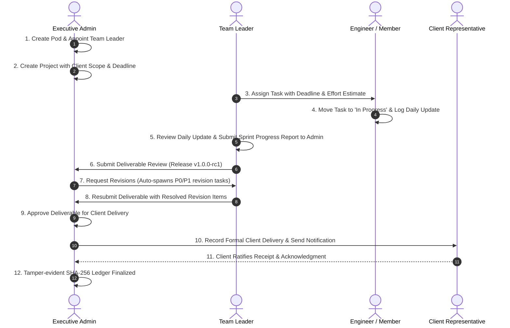

# 🚀 CONTINUITY — Enterprise Project Continuity, Team Governance & Client Delivery Platform

> **CONTINUITY** is an enterprise-grade AI-powered platform for engineering project continuity, team pod management, employee accountability, multi-round deliverable review, and verified client delivery. Built with strict role-based access control (RBAC), tamper-evident cryptographic audit logs (SHA-256), a dual-engine RAG knowledge terminal, and secure BCrypt + JWT session architecture.

---

## 🏛️ Executive Product Architecture

In fast-paced engineering organizations, transfers across shifts, teams, and client milestones often suffer from context fragmentation, unrecorded blockers, missed handoffs, and vague delivery sign-offs.

**CONTINUITY** eliminates this gap by providing an end-to-end governance lifecycle where:
1. **Admins** configure execution pods, appoint and transfer team leaders, establish projects with defined client scopes, monitor real-time organizational KPIs, review milestone deliverables, request structured revisions, and record final client delivery.
2. **Team Leaders** direct execution inside their assigned pods, distribute tasks to engineers, track blockers and deadlines, review daily updates, and report periodic progress to Admins.
3. **Employees** log daily work notes, track assigned tasks through all lifecycle stages, submit evidence, and raise operational blockers without information loss.

---

## 👥 Three-Tier Role-Based Access Control (RBAC)

The platform strictly differentiates access and permissions across three core roles:

| Capability / Action | Admin | Team Leader | Employee |
| :--- | :---: | :---: | :---: |
| **Executive Governance Dashboard** | Full Org-Wide View | Assigned Pod Scope | Personal Task Scope |
| **Create Teams & Appoint Pod Leaders** | ✅ Yes | ❌ No | ❌ No |
| **Transfer Members Between Teams** | ✅ Yes | ❌ No | ❌ No |
| **Create & Assign Projects** | ✅ Yes | ❌ No | ❌ No |
| **Assign & Distribute Tasks** | ✅ Yes | ✅ Yes (Assigned Pods) | ❌ No |
| **Update Task Lifecycle & Log Blockers** | ✅ Yes | ✅ Yes | ✅ Yes (Assigned Tasks) |
| **Submit Employee Daily Work Updates** | ✅ Yes | ✅ Yes | ✅ Yes |
| **Review & Confirm Daily Updates** | ✅ Yes | ✅ Yes (Assigned Pods) | ❌ No |
| **Submit Sprint / Progress Reports to Admin** | ✅ Yes | ✅ Yes | ❌ No |
| **Submit Milestone Deliverables for Review** | ✅ Yes | ✅ Yes | ❌ No |
| **Multi-Round Deliverable Review (Approve / Revisions)** | ✅ Yes | ❌ No (Read-Only) | ❌ No |
| **Record Client Release Delivery** | ✅ Yes | ❌ No | ❌ No |
| **Ratify Client Receipt Acknowledgment** | ✅ Yes | ❌ No | ❌ No |
| **AI Knowledge Query Terminal (RAG)** | ✅ Yes | ✅ Yes | ✅ Yes |
| **View Immutable SHA-256 Audit Ledger** | ✅ Yes | ✅ Yes (Read-Only) | ✅ Yes (Read-Only) |

---

## 🧠 Retrieval-Augmented Generation (RAG) Architecture

The platform includes a dedicated **AI Knowledge Query Terminal** (`/assistant`) anchored by a strict zero-hallucination grounding model:

```mermaid
graph TD
    UserQuery[Engineer / Lead Query] --> Route[/api/assistant or Spring Boot /chat]
    Route --> Sanitizer[Secret & Credential Redaction Filter]
    Sanitizer --> CorpusRetrieval[Multi-Source Corpus Retrieval]

    subgraph "Grounded Enterprise Corpus"
        ADRs[Architectural Decision Records - ADRs]
        Files[Codebase Snapshots & Kernel Runbooks]
        Tasks[Active Tasks & Blocker Registry]
        Handoffs[Handoff Dossiers & Executive Summaries]
    end

    CorpusRetrieval --> ADRs
    CorpusRetrieval --> Files
    CorpusRetrieval --> Tasks
    CorpusRetrieval --> Handoffs

    ADRs --> TokenScoring[Relevance Ranking & Token Overlap Scoring]
    Files --> TokenScoring
    Tasks --> TokenScoring
    Handoffs --> TokenScoring

    TokenScoring --> TopEvidence[Top Grounded Evidence Chunks]
    TopEvidence --> LLMEngine{Inference Engine}
    
    LLMEngine -->|GEMINI_API_KEY Available| Gemini[Google GenAI: gemini-2.5-flash]
    LLMEngine -->|Backend Active| SpringBoot[Spring Boot RagKnowledgeService]
    LLMEngine -->|Offline / Fallback| LocalSynth[Deterministic Grounded Synthesizer]

    Gemini --> FormattedOutput[Synthesized Analysis + Markdown Runbooks + Exact Citations]
    SpringBoot --> FormattedOutput
    LocalSynth --> FormattedOutput
```

### Core RAG Capabilities:
1. **Multi-Source Retrieval**: Aggregates verified context across Architectural Decision Records (ADRs), codebase files (`src/consensus/raft_state.rs`, kernel configs, Envoy proxies), tasks/blockers, and handoff dossiers.
2. **Relevance Scoring & Token Ranking**: Matches query tokens with document titles, decisions, consequences, and code snippets, returning the top relevant evidence chunks.
3. **Secret Redaction Filter**: Automatically scans and strips passwords, JWTs, API keys, bearer tokens, and private keys (`[REDACTED_SECRET]`) before passing context to LLMs.
4. **Dual Inference Engine**:
   - **Google GenAI (`@google/genai`)**: Executes inference via `gemini-2.5-flash` with strict grounding system instructions when `GEMINI_API_KEY` is provided.
   - **Spring Boot RAG Service**: Java 21 backend service querying isolated version snapshots and file indexes (`/api/projects/{projectId}/chat`).
   - **Deterministic Grounded Synthesizer**: Fallback engine generating verified, structured markdown with exact terminal commands and zero hallucinations.
5. **Mandatory Citations**: Every generated response includes exact grounding citations (e.g., `ADR-041`, `Task TASK-201`, `File src/consensus/raft_state.rs`, `HO-2026-089`).

---

## 🔐 Enterprise Authentication & Security Architecture

1. **BCrypt Password Hashing**: Passwords are securely hashed with BCrypt (10 salt rounds).
2. **256-Bit HMAC-SHA256 JWTs**: Authenticated sessions issue signed JSON Web Tokens containing identity claims (`sub`, `systemRole`, `email`, `name`, `department`).
3. **Secure HTTP-Only Cookies**: JWT tokens are stored exclusively in HTTP-only, SameSite=Lax cookies (`continuity_token`), protecting against XSS token exfiltration.
4. **Edge Route Protection (`middleware.ts`)**: Next.js Edge middleware enforces JWT verification on all protected routes (`/dashboard`, `/tasks`, `/projects`, etc.) and all API routes (`/api/*`). Unauthenticated visitors are redirected to `/login` before any layout HTML is sent.
5. **Zero Spoofed Identity Fallback**: All API routes use `requireUser(req)` in `lib/auth.ts`, reading only edge-verified headers (`x-authenticated-user-id`). Client-injected `x-user-id` headers are stripped.
6. **No Default Secrets**: `JWT_SECRET` must be set via environment variables (minimum 32 characters) and fails fast at startup if missing.

---

## 🔑 Test Credentials (1-Click Fill Available)

When running locally with `NEXT_PUBLIC_DEMO_MODE=true`, the `/login` page displays 1-click test credential fill buttons:

| Role | Name | Email / ID | Password | Access Level |
| :--- | :--- | :--- | :--- | :--- |
| **Main Admin** | Yug Chapherkar | `admin@phx.in` (or `EMP-001`) | `12345678` | Full Executive Org Governance |
| **Project Lead** | Marcus Vance | `lead@phx.in` (or `EMP-002`) | `12345678` | Pod Management, Task Assignment, Sprint Reports |
| **Employee** | Jessica Chauhan | `employee@phx.in` (or `EMP-003`) | `12345678` | Personal Workbench, Daily Journal, Blocker Logging |

---

## 📊 Executive Governance Dashboard (10 Real KPI Pulses)

The executive dashboard renders 10 calculated operational metrics without dummy placeholders:

1. **Total Employees** — Active vs. inactive personnel count in directory.
2. **Active Teams** — Operational engineering pods with assigned leaders.
3. **Active Projects** — In-flight development workstreams.
4. **At-Risk Projects** — Workstreams impacted by blockers, revisions, or pending deadlines.
5. **Overdue Tasks** — Incomplete tasks with past operational deadlines.
6. **Pending Reports** — Unreviewed sprint submissions from Team Leaders.
7. **Pending Reviews** — Milestone deliverables awaiting executive sign-off.
8. **Revision Requests** — Deliverables rejected with structured revision tasks.
9. **Approved Releases** — Releases certified by Admin ready for client handover.
10. **Delivered Releases** — Formally delivered releases with client acknowledgment records.

---

## 🔄 End-to-End Enterprise Lifecycle



---

## 🛠️ Technology Stack

| Layer | Technologies | Description |
| :--- | :--- | :--- |
| **Frontend** | Next.js 15 (App Router), React 19, Tailwind CSS | High-performance responsive web client with light/dark theme persistence |
| **API & Server Store** | Next.js Route Handlers + TypeScript | Atomic file-persisted JSON database (`storage/continuity_store.json`) with optimistic locking |
| **Enterprise Backend** | Java 21, Spring Boot 3.3.5 | Enterprise REST controllers, Spring Data JPA, Flyway DB migrations |
| **Database Schemas** | SQLite / PostgreSQL / H2 | Relational schema migrations `V1` through `V7` supporting relational persistence |
| **Security & Auditing** | BCrypt, Jose JWT, SHA-256 | HTTP-only cookie JWT auth and immutable hash-chained audit logging |
| **RAG AI Assistant** | Google GenAI SDK (`@google/genai`), Spring Boot RAG | Context-grounded architectural assistant with zero-hallucination fallback |

---

## 📁 Repository Structure

```
Continuity/
├── app/                              # Next.js 15 App Router
│   ├── (dashboard)/                  # Dashboard & Core Views
│   │   ├── page.tsx                  # Executive Governance Command Center
│   │   ├── admin/teams/page.tsx      # Pod Management & Leader Appointments
│   │   ├── admin/employees/page.tsx  # Employee Directory & Role Allocations
│   │   ├── admin/reviews/page.tsx    # Multi-Round Deliverable Review Matrix
│   │   ├── admin/deliveries/page.tsx # Client Delivery Ledger & Signoff
│   │   ├── reports/page.tsx          # Team Leader Progress Reports
│   │   ├── updates/page.tsx          # Daily Work Update Submissions
│   │   ├── tasks/page.tsx            # Universal Task Board
│   │   ├── notifications/page.tsx    # In-App Alert Center
│   │   ├── projects/page.tsx         # Workspace Manager & Versions
│   │   ├── handoffs/page.tsx         # Digital Handoff Dossiers
│   │   ├── audit/page.tsx            # Cryptographic SHA-256 Ledger
│   │   └── assistant/page.tsx        # AI Knowledge Query Terminal (RAG)
│   ├── api/                          # Next.js REST API Handlers
│   │   ├── assistant/route.ts        # RAG Knowledge Synthesis Endpoint
│   │   ├── auth/login/route.ts       # BCrypt + JWT Authentication Endpoint
│   │   ├── auth/logout/route.ts      # HTTP-Only Cookie Invalidation
│   │   ├── auth/me/route.ts          # Verified Identity Resolution
│   │   ├── users/route.ts            # User onboarding & role updates
│   │   ├── teams/                    # Pod management & member routing
│   │   ├── projects/                 # Project creation & health rules
│   │   ├── tasks/                    # Task lifecycle & assignments
│   │   ├── updates/                  # Daily work notes & leader review
│   │   ├── reports/                  # Sprint progress reports
│   │   ├── reviews/                  # Multi-round deliverable review
│   │   ├── deliveries/               # Client release delivery & receipt
│   │   ├── audit/route.ts            # SHA-256 audit ledger retrieval
│   │   └── notifications/route.ts    # In-app notifications
│   ├── login/page.tsx                # Enterprise Login Portal with Floating Navbar
│   └── page.tsx                      # Landing Page with 100dvh Screen Sections
├── components/
│   ├── employee/EmployeeDashboard.tsx # Comprehensive Engineer Workbench
│   ├── landing/LandingPage.tsx       # Landing Page Component System
│   └── ui/                           # Reusable UI & Layout Components
│       ├── Sidebar.tsx               # Collapsible RBAC Navigation
│       ├── TopBar.tsx                # Global Command Palette (⌘K) & Search
│       └── IridescentWave.tsx        # Ambient Prismatic Glass Wave
├── context/
│   └── AppContext.tsx                # Unified State & Session Synchronization
├── lib/
│   ├── auth.ts                       # JWT Signing, Cookie Config & Auth Helpers
│   ├── types.ts                      # TypeScript Domain Models
│   ├── api.ts                        # Client API Fetchers
│   └── server-store.ts               # Atomic Store Persistence & Authorization Helpers
├── backend/                          # Spring Boot 3.3.5 Application
│   ├── src/main/java/com/continuity/ # Java Services, Controllers, and Repositories
│   │   ├── controller/KnowledgeController.java # Spring Boot RAG REST Endpoint
│   │   └── service/RagKnowledgeService.java    # Spring Boot Knowledge Indexer
│   └── src/main/resources/db/migration/        # Flyway migrations (V1 to V7)
└── tests/
    └── security.test.mjs             # 6-Step Automated Security Verification Suite
```

---

## 🚀 Quickstart Guide

### Prerequisites
- **Node.js** >= 18.18.0
- **Java JDK 21** (if running the Spring Boot backend)
- **Maven 3.9+** (or use the included wrapper)

### Step 1: Environment Setup
Copy the example environment configuration:
```bash
cp .env.example .env
```
Ensure `JWT_SECRET` is set to a secure string of at least 32 characters:
```env
JWT_SECRET="continuity-enterprise-secret-key-2026-secure-hmac-sha256"
DATABASE_URL="file:./continuity.db"
NEXT_PUBLIC_DEMO_MODE=true
# Optional: GEMINI_API_KEY="your-gemini-api-key"
```

### Step 2: Start Next.js Frontend
```bash
npm install
npm run dev
```
Open **`http://localhost:3000`** in your browser.

- **Landing Page:** `http://localhost:3000/`
- **Login Portal:** `http://localhost:3000/login`
- **Executive Dashboard:** `http://localhost:3000/dashboard`
- **RAG Terminal:** `http://localhost:3000/assistant`

---

### Step 3: (Optional) Run the Spring Boot Microservice
```bash
cd backend
mvn spring-boot:run
```
- **Backend API:** `http://localhost:8080/api`
- **Swagger UI:** `http://localhost:8080/swagger-ui.html`

---

## 🧪 Automated Verification & Testing

### 1. Security Verification Suite (Node.js Test Runner)
Verifies unauthorized 401 rejection, forged header stripping, static file extension bypass protection, hardcoded secret rejection, and role-based 403 Forbidden enforcement:
```bash
npm test
```

### 2. TypeScript Compilation Check
Verifies complete type safety across all components and API handlers:
```bash
npx tsc --noEmit
```

### 3. Production Build Validation
Verifies production bundle generation for all 38 static and dynamic routes:
```bash
npm run build
```

---

## 📜 License
Internal Enterprise Use — CONTINUITY Platform Engineering Team.
