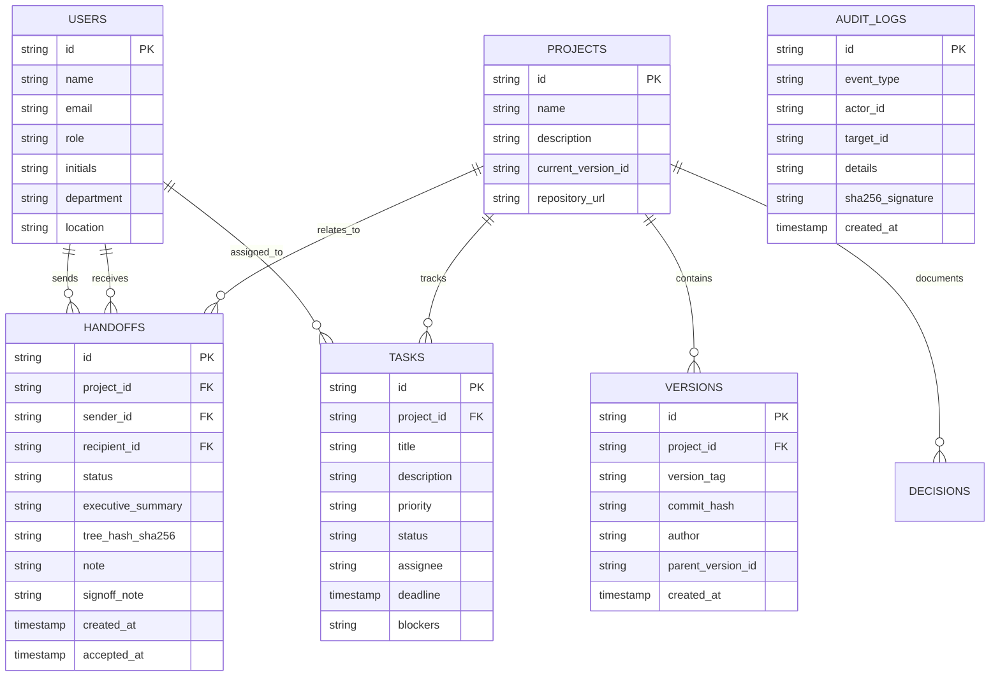

# CONTINUITY — Spring Boot Backend & RAG Engine

Enterprise backend for CONTINUITY — Digital Handoff & Platform Continuity Management.

## Technology Stack
- **Java 21**
- **Spring Boot 3.3.5**
- **Spring Data JPA & PostgreSQL**
- **Flyway Database Migrations** (V1 Schema, V2 Seed Data, V3 Task Deadlines, V4 Team Roster)
- **Spring Security** (Stateless persona-based identity & role/ownership enforcement)
- **Google Gen AI Java SDK** (`com.google.genai:google-genai`)
- **SpringDoc OpenAPI / Swagger 3**
- **Maven 3.10**

---

## Quickstart

### 1. Configure Environment (Optional)
If using Docker PostgreSQL:
```bash
docker compose up -d
```
By default, the application runs out-of-the-box using the embedded file database (`continuity_db`).

To enable AI summary capabilities:
```bash
export GEMINI_API_KEY="your-gemini-api-key"
```

### 2. Run the Backend
```bash
mvn spring-boot:run
```
The REST API starts on `http://localhost:8080`.
- Swagger UI (Interactive API docs): `http://localhost:8080/swagger-ui.html`
- OpenAPI JSON: `http://localhost:8080/v3/api-docs`
- Health check: `http://localhost:8080/api/health`

### 3. Run Automated Tests
```bash
mvn test
```
Runs 19 automated integration tests covering:
- Task operational deadlines & overdue checks
- Pre-submission handoff completeness scoring (0–100%)
- Snapshot version uploads & diff calculations
- Optimistic locking / concurrent edit conflict protection (409 Conflict)
- Complete handoff signoff and tamper-evident audit ledger entries

---

## 🏛️ System Design & Backend Architecture

### 💡 Core System Design Prompt
> **"Design a resilient, high-concurrency backend service in Java 21 & Spring Boot 3 for managing digital shift rotations and engineering handoffs. The service must calculate real-time handoff completeness scores, generate SHA-256 tamper-evident package hashes, protect concurrent code snapshot uploads using optimistic concurrency control (409 Conflict), track task deadlines with overdue flags, and provide contextual grounded question answering using Gemini RAG over historical decisions."**

### 🧩 Core Backend Services & Design Patterns
1. **`HandoffService`**:
   - Calculates automated completeness scores across 4 weighted dimensions:
     - Executive Briefing depth $\ge 20$ chars (+30%)
     - Completed milestones attached (+25%)
     - Non-empty runbook commands (+25%)
     - Next steps specified (+20%)
   - Generates SHA-256 tree hashes for tamper-evident ledger storage.
2. **`VersionService`**:
   - Implements snapshot diff calculation (`Myers` diff algorithm).
   - Enforces optimistic concurrency via `baseVersionId` validation, rejecting stale edits with `409 Conflict`.
3. **`TaskService`**:
   - Manages workspace tasks and operational deadlines (`LocalDateTime`).
   - Automatically computes `isOverdue` status when `deadline < now()` and task state $\ne$ `Done`.
4. **`RagAssistantService`**:
   - Integrates `com.google.genai:google-genai` SDK to ingest ADRs, handoff packages, and code diffs into grounded answers for incoming engineers.

### 🌐 Key REST API Endpoints

| Method | Endpoint | Description |
| :--- | :--- | :--- |
| `GET` | `/api/health` | Service health check |
| `GET` | `/api/users` | List active team members & roster |
| `GET` | `/api/projects` | List all workspaces & active versions |
| `POST` | `/api/projects/{id}/versions` | Upload snapshot with optimistic concurrency guard |
| `GET` | `/api/projects/{id}/diff` | Myers diff between two snapshot versions |
| `GET` | `/api/handoffs` | List all handoff dossiers |
| `POST` | `/api/handoffs` | Dispatch verified handoff package (SHA-256 signed) |
| `POST` | `/api/handoffs/{id}/accept` | Signoff and accept primary custodianship |
| `GET` | `/api/tasks` | Workspace tasks with deadlines and overdue status |
| `POST` | `/api/assistant/query` | Gemini RAG query answering across project history |

---

## 🗄️ Database Schema & Entity-Relationship Diagram



---

## 📦 Flyway Database Migrations

| Migration Script | Scope & Description |
| :--- | :--- |
| `V1__init_schema.sql` | Creates base tables: `users`, `projects`, `versions`, `tasks`, `decisions`, `handoffs`, `audit_logs`. |
| `V2__seed_initial_data.sql` | Seeds foundational workspaces, Raft consensus ADRs, and initial roster. |
| `V3__add_task_deadline.sql` | Adds operational `deadline` (`TIMESTAMP`) column to `tasks` table for overdue tracking. |
| `V4__add_team_members.sql` | Upserts core leads: `user-jessica` (Jessicaa Chauhab), `user-yash` (Yash Lokhande), and `user-shruti` (Shruti Patil). |

---

## 💻 Sample API Usage (cURL Examples)

### 1. Retrieve Active Team Members
```bash
curl -X GET http://localhost:8080/api/users \
  -H "Accept: application/json"
```

### 2. Dispatch a Lossless Handoff Dossier
```bash
curl -X POST http://localhost:8080/api/handoffs \
  -H "Content-Type: application/json" \
  -H "X-User-Id: user-yash" \
  -d '{
    "projectId": "proj-apollo",
    "recipientId": "user-jessica",
    "note": "APAC to EMEA shift rotation",
    "executiveSummary": "All Raft consensus nodes are green; staged PR #104 ready for canary deployment.",
    "completedItems": ["Verified zero packet drop", "Ran automated failover probe"],
    "nextSteps": ["Monitor p99 latency during 14:00 UTC spike"],
    "criticalBlockers": [],
    "runbookCommands": ["./bin/apollo-ctl cluster status"]
  }'
```

### 3. Accept Handoff & Sign Off Custodianship
```bash
curl -X POST http://localhost:8080/api/handoffs/HO-2026-089/accept \
  -H "Content-Type: application/json" \
  -H "X-User-Id: user-jessica" \
  -d '{
    "signoffNote": "Attested readiness and assumed primary operational custodianship."
  }'
```

### 4. Query AI Continuity Assistant
```bash
curl -X POST http://localhost:8080/api/assistant/query \
  -H "Content-Type: application/json" \
  -d '{
    "projectId": "proj-apollo",
    "query": "What are the latest ADR decisions made regarding Raft consensus leases?"
  }'
```

---

## ⚙️ Configuration Properties Reference

| Property Key | Default Value | Description |
| :--- | :--- | :--- |
| `server.port` | `8080` | HTTP port for the Spring Boot REST API |
| `spring.datasource.url` | `jdbc:h2:file:./storage/db/continuity_db;...` | Database JDBC URL (PostgreSQL in production) |
| `spring.jpa.hibernate.ddl-auto` | `validate` | Validates JPA entities against Flyway migrations |
| `spring.flyway.enabled` | `true` | Automated migration runner |
| `gemini.api.key` | `${GEMINI_API_KEY:}` | Google Gemini API key for grounded RAG |
| `continuity.cors.allowed-origins` | `http://localhost:3000` | Allowed CORS origins for Next.js web client |

---

## 🚦 Error Handling & HTTP Status Matrix

| Status Code | Reason | Example Trigger |
| :--- | :--- | :--- |
| `200 OK` | Request succeeded | Data fetched or handoff accepted successfully |
| `201 Created` | Resource created | Handoff dossier dispatched or task registered |
| `400 Bad Request` | Missing mandatory fields | Empty executive summary or unassigned task |
| `404 Not Found` | Entity not located | Non-existent handoff ID or user ID |
| `409 Conflict` | Optimistic Concurrency Conflict | Snapshot uploaded against an outdated `baseVersionId` |
| `500 Internal Error` | Unhandled runtime exception | Database connection timeout or upstream API failure |

